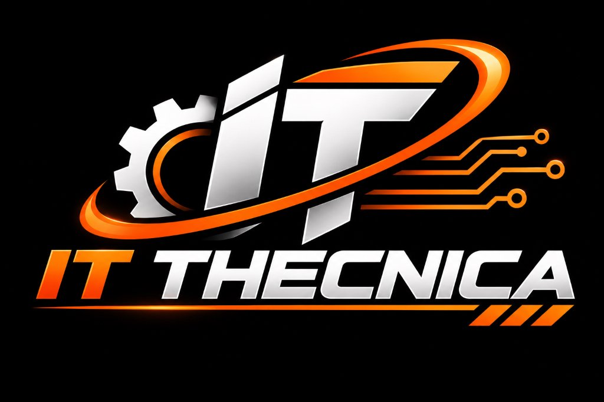
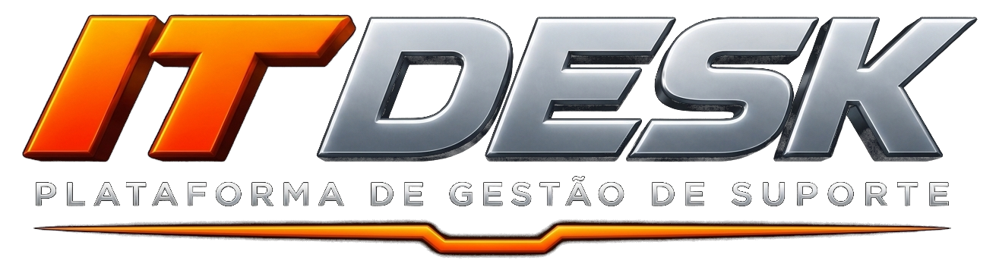
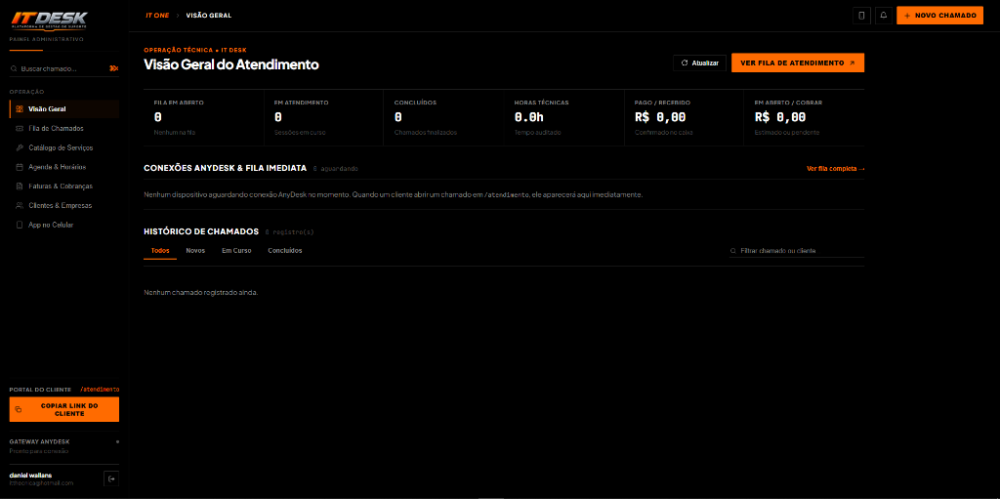
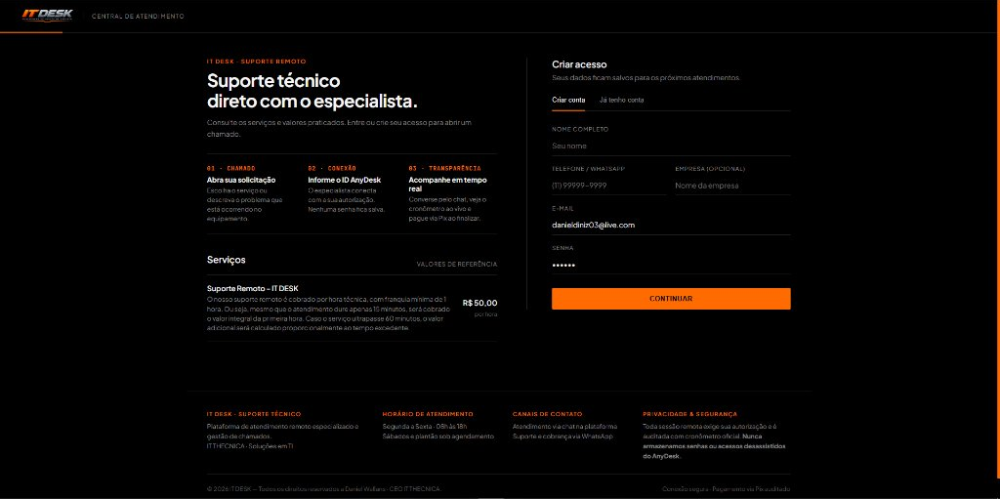
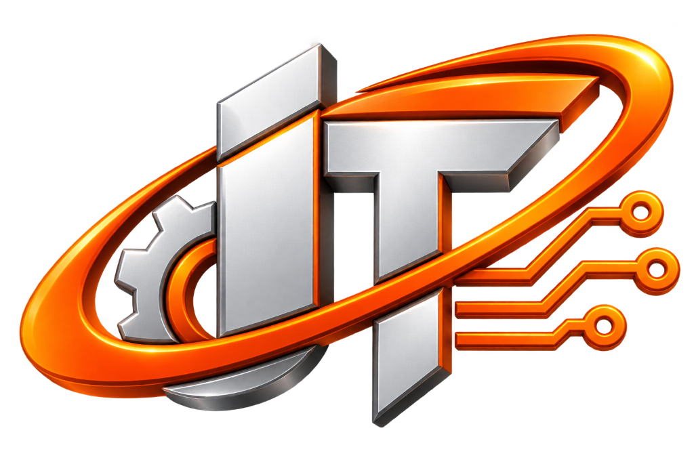

  

    

  <h1>IT THECNICA</h1>
  
<strong>Tecnologia que move o seu próximo nível.</strong>

  
Soluções inteligentes em manutenção de hardware, infraestrutura técnica e desenvolvimento de sistemas web proprietários.

---

## ⚡ Sobre a IT THECNICA

A **IT THECNICA** é uma empresa especializada em soluções completas de tecnologia. Atuamos desde a manutenção física de computadores e equipamentos de alto desempenho até a arquitetura e desenvolvimento de sistemas web sob medida, portais de atendimento e automações corporativas.

Nosso foco é resolver desafios reais com proximidade, transparência e excelência técnica — eliminando burocracias e entregando resultados práticos.

---

## 🛠️ Frentes de Atuação

### 01 · Manutenção de Computadores & Hardware
- Diagnóstico especializado, manutenção preventiva e corretiva para desktops e notebooks.
- Otimização de performance, montagem de setups de alta estabilidade e substituição criteriosa de componentes.

### 02 · Manutenção de Impressoras & Equipamentos
- Limpeza preventiva técnica, recuperação e desobstrução de cabeçotes de impressão.
- Pressurização em sistemas de dampers, calibração e aumento da vida útil de equipamentos.

### 03 · Desenvolvimento Web & Portais Sob Medida
- Criação de páginas institucionais e comerciais de alto impacto visual e alta velocidade.
- Portais exclusivos para clientes com acompanhamento em tempo real e abertura de solicitações online.

### 04 · Sistemas de Gestão & Automações
- Painéis administrativos completos construídos sob medida para a regra de negócio do cliente.
- Integração de filas em tempo real, telemetria de suporte e liquidação financeira automatizada via Pix.

---

## 🚀 Projeto em Destaque: IT DESK

  

Desenvolvido integralmente pela **IT THECNICA**, o **IT DESK** é um ecossistema proprietário de gestão operacional e atendimento técnico remoto:

- **Central Operacional do Especialista**: Telemetria ao vivo, monitoramento de conexões AnyDesk, fila auditada e controle financeiro de pagamentos Pix.
- **Portal do Cliente (`/atendimento`)**: Abertura direta de chamados com checklist inteligente, chat ao vivo e liquidação Pix imediata.

  
  

---

## 💎 Identidade & Compromisso

- **Transparência e Rigor Técnico**: Atendimento direto sem intermediários, diagnóstico sincero e peças de procedência comprovada.
- **Engenharia Própria**: Sistemas rápidos, sem templates genéricos ou layouts pesados. Visual limpo, responsivo e pensado para a rotina diária.

---

  
    
  
<strong>© 2026 IT THECNICA — Todos os direitos reservados.</strong> 
  Desenvolvido e operado por <strong>Daniel Wallans</strong> · CEO & Especialista Técnico

